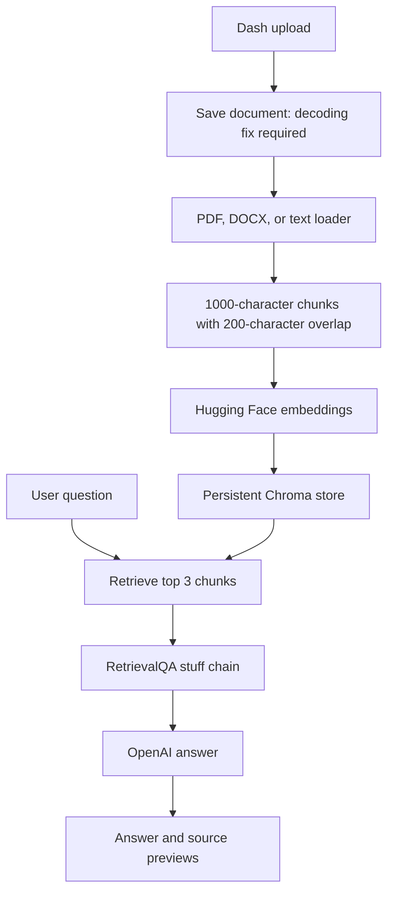

# Financial Document Analyzer

### A document-question-answering prototype with semantic retrieval and source previews

A **Python and Dash prototype** connecting document loaders, text chunking, Hugging Face embeddings, Chroma storage, and LangChain retrieval-based question answering. The interface provides multiple-file upload, a natural-language query box, answer and source-preview sections, and a separate CrewAI analysis panel.

The engineering focus is making document content searchable and supplying retrieved passages to a language model, rather than asking the model to answer from general knowledge alone.

[Read the implementation](./app.py)

> **Stage:** Source prototype with significant integration gaps. Upload content is not decoded before writing, the CrewAI panel does not receive document content, and the graph is unpopulated. There are no committed sample documents, saved results, or execution tests establishing a working end-to-end application. No application or model calls were run for this documentation.

---

## The problem

Financial reports can contain lengthy narrative sections and numerical disclosures. Locating relevant passages is a different task from interpreting them.

This project attempts to connect those tasks: extract document text, split it into searchable chunks, retrieve relevant passages for a question, and generate an answer with source previews for a reader to inspect.

The intended role is document research assistance. It does not implement audited financial extraction, verified calculations, valuation, or investment decision-making.

## Intended value

| Document-review need | Source implementation |
|---|---|
| Search across uploaded material | Shared Chroma vector store |
| Match meaning rather than exact text | `all-MiniLM-L6-v2` embeddings |
| Supply context to answer generation | LangChain `RetrievalQA` with top-three retrieval |
| Let readers inspect supporting passages | Page metadata and 200-character source previews |
| Make interaction accessible | Dash and Bootstrap interface |

These are design capabilities, subject to the upload and compatibility issues below. Accuracy, analyst time saved, retrieval quality, and financial impact have not been measured.

## Intended RAG pipeline



### Document ingestion

`process_uploaded_files()` chooses a loader based on the filename:

| Extension | Loader selected |
|---|---|
| `.pdf` | `PyPDFLoader` |
| `.doc` or `.docx` | `Docx2txtLoader` |
| Any other extension | `TextLoader` |

The extension selection is routing logic, not proof that all those formats are successfully supported. In particular, routing legacy `.doc` through a DOCX loader does not establish legacy Word compatibility. There is no OCR, file-signature validation, or dedicated financial-table extraction.

### Chunking and storage

The source configures `RecursiveCharacterTextSplitter` with `chunk_size=1000` and `chunk_overlap=200`. It embeds the resulting text using `all-MiniLM-L6-v2` and creates a Chroma store at:

```text
data/chroma_db/
```

The `data/` directory is created at runtime next to `app.py`. There is no document deletion, collection-reset interface, deduplication policy, or per-user index isolation. Repeated uploads use the same persistence location.

### Question answering

The query callback loads the vector store, requests three chunks, and builds a `RetrievalQA` chain with:

```text
model: gpt-3.5-turbo
temperature: 0
chain_type: stuff
return_source_documents: True
```

The UI displays the generated answer and a preview of each returned source document: its page metadata and the first 200 characters of text. Filenames are not included in that display, and retrieved passages are not mapped to individual answer claims.

Source previews support manual inspection; they do not independently verify the answer. There is no retrieval-quality threshold or explicit insufficient-evidence decision in the application code.

## Two independent result panels

The Search button triggers both the RAG query callback and the CrewAI analysis callback. They are separate branches, not a pipeline in which the analyst receives the retrieved answer or evidence.

The CrewAI branch creates one `Financial Analyst` agent and one task. Its task description includes only the user's question. No uploaded text, retrieved chunks, vector-store tool, or research result is passed to the agent.

Accordingly, that panel cannot currently be described as analyzing the uploaded documents. It generates an analysis request without the underlying evidence. Its model is not explicitly configured in source.

The result of `crew.kickoff()` is passed directly to `html.P`. Depending on the framework version, this may be a structured result object requiring conversion to renderable text.

## Current integration gaps

### Upload payload handling

Dash's upload component supplies encoded content as a data-URI string. The source opens a file in binary mode and calls `f.write(content)` directly. It neither strips the data-URI header nor base64-decodes the payload.

With the component's normal string input, this causes a type error rather than writing valid document bytes. Fixing that boundary is necessary before the ingestion flow can be exercised through the UI.

### Upload path handling

The filename is joined directly to the upload directory without normalization or validation. A stronger implementation should resolve the destination within the intended directory, generate safe storage names, and define overwrite and size-limit behavior.

### Unpopulated visualization

The layout contains `dcc.Graph(id="document-graph")`, but no callback supplies its figure. Imported pandas and Plotly functionality is not used to build charts. This is not currently a working visualization feature.

### Missing reproducible environment

The repository contains `app.py` and `README.md` only. The existing installation instructions reference a `requirements.txt` that is not committed. There is no dependency lockfile, tested Python-version declaration, or compatibility record.

The code combines version-sensitive LangChain community imports, `RetrievalQA`, Chroma persistence calls, CrewAI settings, and Dash's `run_server`. A compatible environment must be established before promising a successful launch.

### Credential loading

The source does not call `load_dotenv()`. Creating a `.env` file alone does not make its values available through this application's own loading logic. The OpenAI key must be available to the process through an appropriate environment setup.

## Development preparation

```bash
git clone https://github.com/FaiazS/Financial-Document-Analyzer.git
cd Financial-Document-Analyzer
python -m venv .venv
```

Before launch:

1. Establish and pin a compatible environment for Dash, Dash Bootstrap Components, LangChain/community integrations, Chroma, Hugging Face embeddings, document parsers, and CrewAI. The source also imports pandas and Plotly.
2. Repair upload decoding and safe filename handling.
3. Configure credentials in the process environment and verify the configured model's availability.
4. Decide whether to disable the ungrounded analysis panel or pass it explicit retrieved evidence.
5. Use a small, non-sensitive text document to verify the ingestion boundary before evaluating financial reports.

The intended entry point is:

```bash
python app.py
```

It calls `app.run_server(debug=True)` and is intended for local development, normally accessed at `http://127.0.0.1:8050/`. This command was not executed for the review and is not a verified startup guarantee for the unchanged source.

Embedding initialization may download a model. Querying sends retrieved content to the configured language-model provider, and the shared on-disk index retains document representations. Use only documents appropriate for the configured environment and providers.

## Repository and runtime layout

```text
Financial-Document-Analyzer/
├── app.py
├── README.md
└── data/                  # Created at runtime; not committed
    ├── uploaded files
    └── chroma_db/
```

No sample financial documents, evaluation dataset, test suite, or saved analysis outputs are committed.

## Next engineering milestones

1. **Repair ingestion:** Decode uploads, validate formats, protect paths, and provide clear extraction errors.
2. **Make retrieval inspectable:** Preserve filenames, pages, document IDs, and full supporting passages.
3. **Ground the analysis panel:** Supply retrieved evidence explicitly and distinguish source facts from generated interpretation.
4. **Handle insufficient evidence:** Return uncertainty when passages do not support an answer.
5. **Verify financial values:** Add deterministic extraction and checks for amounts, currencies, units, dates, and reporting periods.
6. **Implement or remove the graph:** Give it a defined data contract and callback rather than implying existing visual analysis.
7. **Isolate document state:** Define collection ownership, retention, deletion, and duplicate-upload behavior.
8. **Create a reproducible evaluation:** Pin dependencies and measure retrieval relevance, answer support, and numerical accuracy on a small labeled document set.

These are proposed extensions, not implemented features.

## Skills demonstrated

**Python · Dash callbacks · Document-loader integration · Text chunking · Embeddings · Chroma vector storage · Retrieval-based generation · Source-preview presentation · CrewAI task configuration**

The strongest portfolio idea is connecting a document interface to semantic retrieval and evidence-visible answers. Repairing ingestion and ensuring every analysis stage receives the documents would make that design a more credible foundation for financial-document research.

---

**Author:** [Faiaz Ahmed](https://www.linkedin.com/in/faiazahmed22/) · [GitHub](https://github.com/FaiazS)
